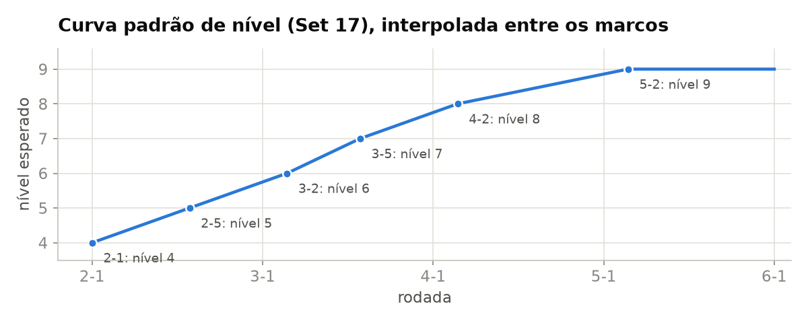
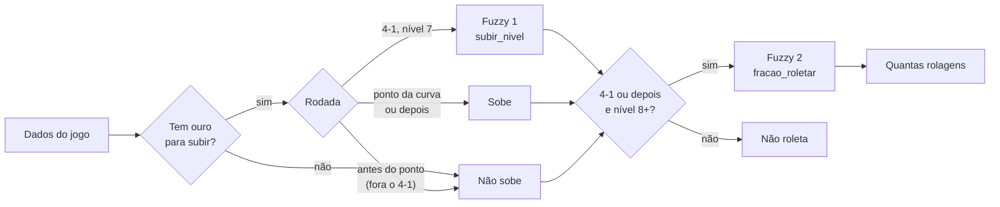
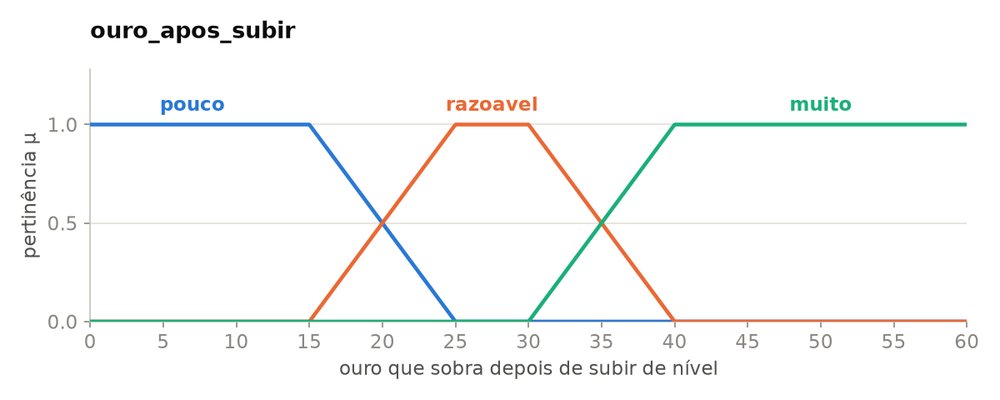
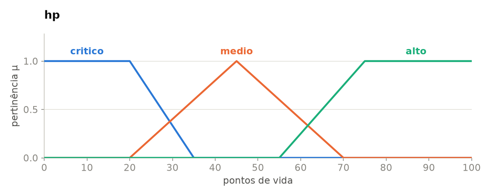
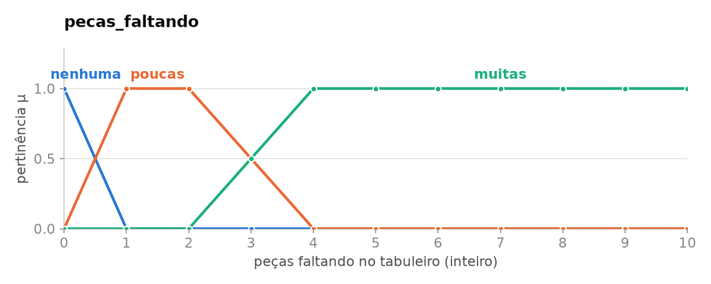
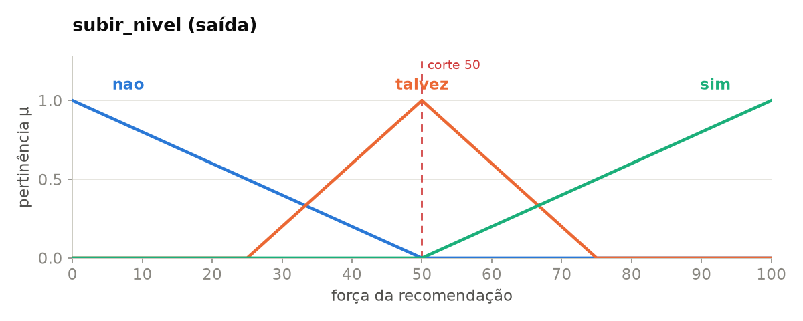
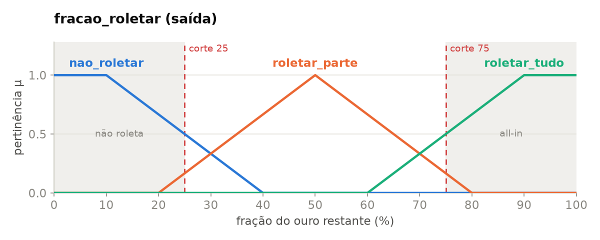

# SBC Fuzzy para decisões de economia no Teamfight Tactics

## Informações do aluno

**Aluno:** Diego de Carvalho Dias  
**Matrícula:** 20230089696

## 1. Motivação

No [Mini-Projeto 1](../mini-projeto-1/README.md), o sistema dizia se o jogador devia **roletar**, **salvar ouro** ou **subir de nível**. As regras eram nítidas e as entradas eram categorias: HP `baixo` ou `alto`, ouro `baixo` ou `alto`.

Isso tinha três problemas:

- **Quem decidia o que é "HP baixo" era o usuário.** 34 e 36 de HP podiam dar respostas opostas.
- **Subir de nível e roletar não são excludentes.** No jogo, é comum fazer os dois na mesma rodada.
- **"Roletar" não dizia quanto.**

Neste projeto, o mesmo problema é resolvido com lógica fuzzy. O jogador informa os números que vê na tela, e o sistema responde algo como:

> **"Suba para o nível 8 e rolete 8 vezes, guardando 14 de ouro."**

## 2. Como o jogo funciona

No Teamfight Tactics, o jogador gasta ouro de duas formas:

- **Comprando XP** para subir de nível. São 4 de ouro por 4 de XP. Cada nível libera mais um espaço no tabuleiro e melhora as chances de aparecerem unidades caras na loja.
- **Roletando a loja** para procurar as unidades que faltam. Cada rolagem custa 2 de ouro.

A partida é dividida em estágios de 7 rodadas, escritos como `estágio-rodada`: `4-2` é a segunda rodada do estágio 4. Quem perde um combate perde HP, e quem chega a 0 é eliminado.

### Quando subir de nível

Jogadores costumam seguir uma curva padrão. O nível 8 em `4-2`, por exemplo, é o momento clássico de subir e roletar para achar as unidades de custo 4. Quem tem bastante ouro pode subir uma rodada antes, em `4-1`. A partir do estágio 4, não se roleta no nível 7: primeiro se sobe para o 8.



O XP necessário para subir aumenta a cada nível:

| Nível atual | 1 | 2 | 3 | 4 | 5 | 6 | 7 | 8 | 9 |
| --- | --- | --- | --- | --- | --- | --- | --- | --- | --- |
| XP para o próximo | 2 | 2 | 6 | 10 | 20 | 36 | 48 | 76 | 84 |

Esses valores mudam um pouco entre sets. Por isso ficam como constantes no topo do notebook.

## 3. Premissas

- O jogador segue a **estratégia padrão**, sem reroll nem fast level.
- **Só se roleta a partir de 4-1 e no nível 8 ou mais.** Os estágios 2 e 3 são de economia, e roletar no 7 a partir do estágio 4 desperdiça ouro.
- Os **juros não entram** no modelo.
- Não há aprimoramentos que dão espaços extras. O número de espaços no tabuleiro é igual ao nível.

## 4. Como o sistema funciona

São duas perguntas, respondidas em ordem:

1. **Devo subir de nível?** Na maior parte do jogo, a curva padrão decide. A dúvida de verdade é em **4-1**: subir para o 8 agora ou esperar 4-2? Quem decide isso é um controlador fuzzy, pelo ouro que sobra e pelo HP.
2. **Quanto do ouro que sobrou devo gastar roletando?** Outro controlador fuzzy, pelas peças que faltam e pelo HP.



Vale separar o que é crisp do que é fuzzy. O calendário da curva e "não dá para subir sem ouro" são limites definidos. "Pouco ouro", "HP crítico" e "muitas peças faltando" são conceitos vagos. É a mesma divisão que a Aula 3 propõe.

## 5. Entradas

O usuário informa só o que aparece na tela:

| Entrada | Exemplo |
| --- | --- |
| `estagio` | `"4-1"` |
| `nivel` e `xp` | nível 7 com 8 de XP |
| `ouro` | 60 |
| `hp` | 60 |
| `pecas_faltando` | 3 |

Uma peça conta como **faltando** quando a unidade certa ainda não está no tabuleiro, ou quando está, mas sem as estrelas que o jogador quer.

Com esses dados, o sistema calcula o **ouro que sobra depois de subir**. Nível 7 com 8/48 de XP precisa de 40 de XP, ou seja, 40 de ouro. Com 60 de ouro, sobram 20.

## 6. Variáveis linguísticas

Cada variável tem três termos. Os gráficos mostram o quanto cada valor pertence a cada termo.

### Entradas



Abaixo de 20 de ouro sobrando é **pouco**: sobe e fica sem ouro para roletar. De 20 a 34 é **razoável**. Com 35 ou mais é **muito**: dá para subir e ainda fazer um bom roll-down. Nas fronteiras, o valor pertence meio a cada termo.



No fim do jogo, uma derrota custa de 10 a 20 de HP. Abaixo de uns 30, uma ou duas derrotas eliminam o jogador: esse é o HP **crítico**.



**Nenhuma** é exatamente 0: a composição está pronta. Com 1 ou 2 peças faltando, são **poucas**; com 4 ou mais, **muitas**. Com 3, o valor fica no meio do caminho entre as duas.

### Saídas



Na prática, ou você compra XP até subir, ou não compra nada. Por isso a saída tem um corte: **com 50 ou mais, sobe**. O número mostra a força da recomendação: 90 é "suba com certeza", e 52 é "suba, mas foi por pouco".



É a porcentagem do ouro restante que vai para a loja. As faixas cinzas são zonas mortas: **abaixo de 25 % não roleta, acima de 75 % gasta tudo.** Elas existem porque o centroide nunca chega exatamente a 0 ou a 100 %.

## 7. Regras

### Regras crisp

| ID | Regra |
| --- | --- |
| C1 | Se não tem ouro para pagar o XP, não sobe. |
| C2 | Se já chegou ao ponto da curva do próximo nível (2-1, 2-5, 3-2, 3-5, 4-2, 5-2), ou passou dele, sobe. |
| C3 | Em 4-1, no nível 7, o Fuzzy 1 decide. Com `subir_nivel` de 50 ou mais, sobe. |
| C4 | Em qualquer outra situação, não sobe. |
| C5 | Só roleta a partir de 4-1 e no nível 8 ou mais. |
| C6 | Rolagens = fração × ouro restante ÷ 2. |

### Fuzzy 1: subir para o 8 em 4-1?

| ouro que sobra \ hp | crítico | médio | alto |
| --- | --- | --- | --- |
| **pouco** | sim | não | não |
| **razoável** | sim | talvez | talvez |
| **muito** | sim | sim | sim |

Com muito ouro sobrando, sobe uma rodada antes e já roleta. Com pouco, espera 4-2. Com HP crítico, sobe de qualquer jeito, porque precisa do tabuleiro mais forte agora.

### Fuzzy 2: quanto roletar?

| peças \ hp | crítico | médio | alto |
| --- | --- | --- | --- |
| **nenhuma** | não roletar | não roletar | não roletar |
| **poucas** | roletar tudo | roletar parte | não roletar |
| **muitas** | roletar tudo | roletar tudo | roletar parte |

Quanto mais peças faltam e menor é o HP, mais se roleta. Com a composição pronta, nunca se roleta.

São **18 regras fuzzy**, e toda combinação de termos tem uma regra.

## 8. Exemplos passo a passo

### 4-1: subir agora ou esperar?

Nível 7 com 8/48 de XP, 60 de ouro, 60 de HP.

1. Subir custa 40, então sobram **20**: meio "pouco", meio "razoável".
2. O HP 60 é 40 % "médio" e 25 % "alto".
3. Quatro regras disparam: duas dizem "não" (pouco) e duas dizem "talvez" (razoável).
4. O resultado é **35**, abaixo de 50: **espera 4-2**. Como continua no 7, não roleta.

Com 80 de ouro, sobrariam 40 ("muito"), e a resposta seria subir em 4-1 e já roletar. Com HP 18, subiria mesmo sobrando 4.

### 4-2: roll-down

Mesmo jogador, uma rodada depois, com 70 de ouro e 3 peças faltando.

1. 4-2 é o ponto da curva do nível 8: **sobe** (C2) e gasta 40. Sobram 30.
2. 3 peças são meio "poucas", meio "muitas". O HP 60 é 40 % "médio" e 25 % "alto".
3. Quatro regras disparam: "roletar tudo", "roletar parte" (duas vezes) e "não roletar", cada uma com sua força.
4. O resultado é **54 %** dos 30 de ouro: **8 rolagens**, guardando 14.

Nenhuma regra decidiu sozinha. O resultado é um meio-termo que faz sentido: o jogador precisa de peças, mas ainda tem HP para não ir all-in.

## 9. Casos de teste

Os três primeiros são os casos obrigatórios, comentados no notebook.

| # | Situação | Entrada | Resultado |
| --- | --- | --- | --- |
| 1 | Subir em 4-1 ou esperar? | 4-1, nível 7 (8/48), 60 de ouro, HP 60, faltam 3 | `subir_nivel` = 35: espera 4-2 e guarda 60 |
| 2 | Roll-down em 4-2 | 4-2, nível 7 (8/48), 70 de ouro, HP 60, faltam 3 | Sobe para o 8 e roleta 8×, guardando 14 |
| 3 | HP crítico em 4-1 | 4-1, nível 7 (8/48), 44 de ouro, **HP 18**, faltam 2 | `subir_nivel` = 83: sobe e gasta os 4 restantes |
| 4 | 4-1 com muito ouro | 4-1, nível 7 (8/48), 80 de ouro, HP 80, faltam 4 | Sobe e roleta 10×, guardando 20 |
| 5 | Economia no estágio 3 | 3-3, nível 6 (10/36), 42 de ouro, HP 80, faltam 4 | Não sobe, não roleta, guarda 42 |
| 6 | Composição pronta | 4-5, nível 8 (10/76), 58 de ouro, HP 85, faltam 0 | Não sobe, não roleta, guarda 58 |
| 7 | Sem ouro para o 8 | 4-3, nível 7 (0/48), 30 de ouro, HP 55, faltam 4 | Não sobe e não roleta no 7: guarda 30 |

O notebook também testa os **pontos da curva de nível** (2-1, 2-5, 3-2, 3-5, 4-2 e 5-2):

| Situação | Decisão |
| --- | --- |
| No ponto, um nível abaixo, com a barra de XP vazia ou quase cheia | sobe |
| No ponto, já no nível esperado | não sobe |
| Na rodada anterior ao ponto | espera, exceto em 4-1, onde o Fuzzy 1 decide |

## 10. Fuzzy × MP1

### Sem saltos

Estágio 4-3, faltando 3 peças, mudando só o HP:

| HP | 20 | 30 | 40 | 50 | 60 | 70 | 80 |
| --- | --- | --- | --- | --- | --- | --- | --- |
| Ouro gasto roletando | 84 % | 63 % | 64 % | 64 % | 54 % | 36 % | 36 % |

No MP1, esse cenário só tinha duas respostas, e a decisão mudava de uma vez no ponto em que o usuário resolvia que "baixo" virava "alto". Aqui, o gasto diminui aos poucos.

### Comparação

| | MP1 | MP2 |
| --- | --- | --- |
| Entradas | Categorias escolhidas pelo usuário | Números do jogo |
| Saída | Uma de três ações | Subir ou não, e quantas rolagens |
| Regras | 18 crisp | 18 fuzzy + 6 crisp |
| Fronteiras | Saltos | Transições suaves |
| Explicação | Quais regras dispararam | Quais regras dispararam e com que força |
| Trabalho de modelagem | Escrever condições | Escrever regras e desenhar as curvas |

O fuzzy é mais expressivo, mas também dá mais trabalho: cada curva precisa de justificativa e de testes. E as regras crescem rápido. Com 3 termos por variável, 2 entradas dão 9 regras, e 3 entradas já dariam 27.

## 11. Limitações

- **Peças faltando é um número inteiro,** então a transição suave só aparece com 3 peças. Daria para pesar cada peça pelo custo: faltar uma unidade de custo 5 é pior do que faltar uma de custo 1.
- **Só a estratégia padrão.** Reroll e fast level precisariam de regras próprias.
- **Sem juros.** Na prática, jogadores costumam roletar "até 50" para manter os juros.
- **Sequência de vitórias ou derrotas** também pesa nas decisões reais e ficou de fora.

## 12. Como executar

1. Abra [SBC_TFT_Fuzzy.ipynb](SBC_TFT_Fuzzy.ipynb) no [Google Colab](https://colab.research.google.com/).
2. Clique em **Ambiente de execução → Executar tudo**. A primeira célula instala o `scikit-fuzzy`.
3. No final do notebook, teste sua própria situação:

```python
recomendar(estagio="4-1", nivel=7, xp=8, ouro=60, hp=60, pecas_faltando=3)
```

Para rodar no computador:

```bash
pip install scikit-fuzzy numpy scipy matplotlib networkx jupyter
jupyter notebook SBC_TFT_Fuzzy.ipynb
```

## 13. Entrega

- [x] Definir domínio, variáveis e regras.
- [x] Implementar os controladores em `scikit-fuzzy`.
- [x] Rodar e comentar os casos de teste.

## Referências

- SOUZA, D. F. L. *Notas de Aula: Lógica Fuzzy*. SBC, 2026.2.
- ZADEH, L. A. "Fuzzy Sets". *Information and Control*, 1965.
- MAMDANI, E. H.; ASSILIAN, S. "An experiment in linguistic synthesis with a fuzzy logic controller", 1975.
- [scikit-fuzzy](https://scikit-fuzzy.github.io/scikit-fuzzy/)
- [TFT Leveling Guide 2026 (tapin.gg)](https://tapin.gg/blogs/tft-leveling-guide-2026)
